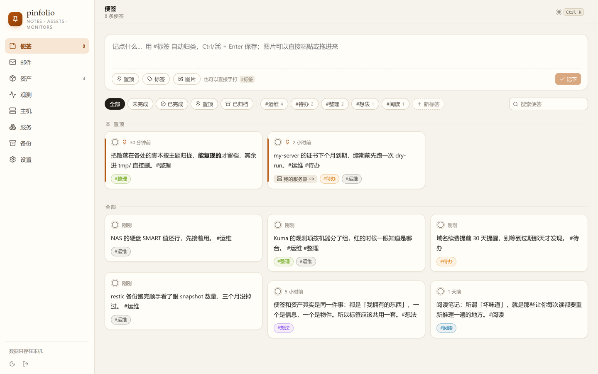
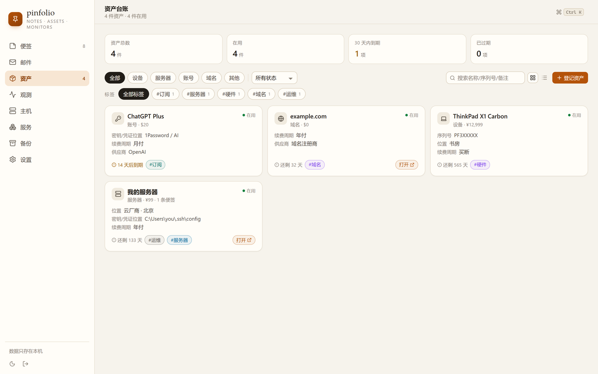
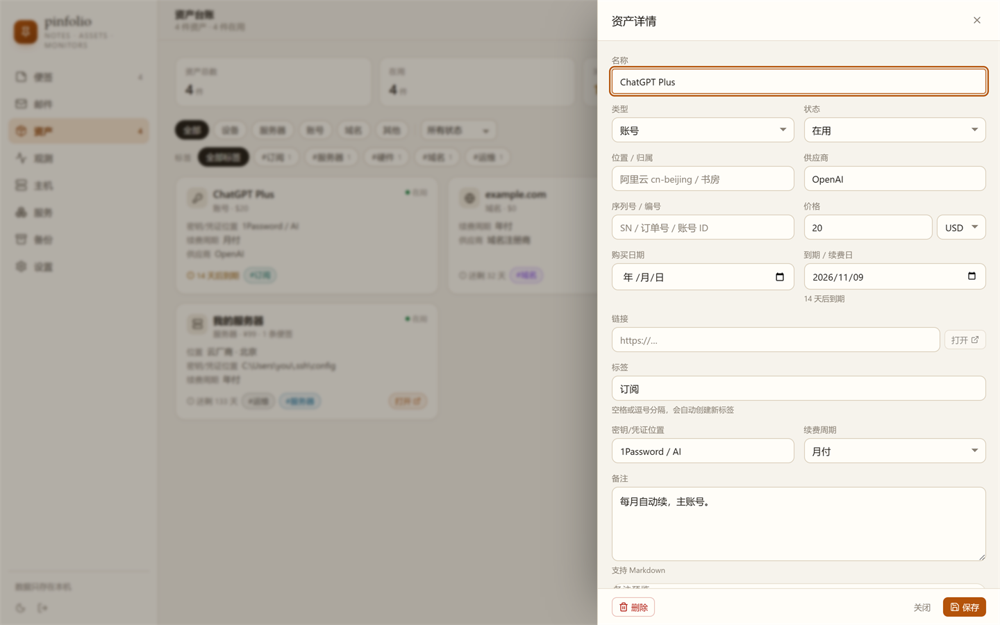

# 便签夹 · pinboard

一个跑在本机的小工具：**随手写便签**，加 `#标签` 自动归类，再配一份**资产台账**，把服务器、域名、账号、设备这些东西登记清楚——到期了会提醒，便签能直接钉在某条资产上。再加一页**观测台**，把所有机器/服务的实时状态并排摆出来。

单进程、单端口、单个 SQLite 文件，不联网、无账号、无 Docker。打开 http://127.0.0.1:7788 就能用。

- 位置：`D:\pinfolio`（2026-10-19 从 `D:\projects\pinboard` 整体迁出，同日与观测后端 `D:\kuma` 合并到工作区根 `D:\pinfolio`）
- 技术栈：Node 24 + TypeScript + Hono + `node:sqlite`；前端 Vite 7 + React 19 + 手写 CSS
- 数据：`data/pinboard.db`（只在本机）

## 截图

| 便签 | 资产台账 |
|---|---|
|  |  |

| 资产详情抽屉 | 标签选择器 |
|---|---|
|  |  |

| 完成态（双击卡片切换） | 深色模式 |
|---|---|
|  |  |

| 观测台（15 个观测项一屏放完） |
|---|
|  |

## 功能

### 便签
- 顶部输入框直接写，**Ctrl / ⌘ + Enter** 保存；支持 Markdown（标题、列表、代码块、链接）。
- 正文里写 `#标签` 会自动归类，中文标点后面也能识别（`。#整理` 有效），标签颜色自动分配。
- **完成状态**：点卡片左侧的圆圈，或**双击卡片正文**，标记「已完成」；再点/再双击回到未完成。完成态是绿色对勾 + 「已完成」胶囊 + 正文淡化加删除线，卡片原地不动、不会跳走。
- 筛选：全部 / 未完成 / 已完成 / 置顶 / 按标签 / ＋新标签；右侧可搜索（防抖）。
- 置顶的便签单独成区，永远排在最上面。
- 行内编辑（铅笔）、**归档**（Archive 图标，默认列表不再有删除）、把便签关联到某条资产。
- **已归档**：归档的便签默认不显示，点筛选行的「已归档」chip（带条数）进只读视图，在那里才能「恢复」或「永久删除」（红色按钮 + 确认弹窗）。Ctrl+K 全局搜索不返回归档便签。

### 标签
- 内置 12 个预设标签：待办、想法、阅读、工作、学习、生活、灵感、重要、整理、运维、账号、购物（`server/db.ts` 的 `PRESET_TAGS`，只在首次建库时写入一次，删掉不会自己长回来）。
- 输入框下方「标签」按钮打开弹层，点一下就插入 `#标签 `，不用记拼写；弹层底部可**新建标签**（名称 + 颜色）。
- 筛选行只显示「有便签在用」的标签，避免刷屏；完整列表在弹层和设置页里。
- 标签在便签和资产之间**共用同一套**——这也是把两者做进一个应用的原因。

### 资产台账
- 类型：设备 / 服务器 / 账号 / 域名 / 其他；状态：在用 / 闲置 / 退役 / 丢失（列表按 在用 → 闲置 → 其他 排序）。
- 通用字段：名称、位置、供应商、序列号、价格 + 币种、购买日期、到期日期、链接、备注（Markdown）。
- **自定义字段**：在设置页定义 key、显示名、类型（文本 / 数字 / 日期 / 链接 / 单选 / 布尔），所有资产通用。当前预置了 `ip`（IP / 地址）、`login`（登录方式）、`secret_at`（密钥 / 凭证位置）、`renew_cycle`（续费周期：月付 / 季付 / 年付 / 买断）。
- 到期提醒：卡片和统计卡按天数显示「还剩 N 天 / 已过期」，30 天内到期会高亮计数。
- 卡片视图 / 表格视图切换；按类型、状态筛选；**标签栏**常显「有资产在用」的标签（`#标签 数量`，按关联数从多到少、同数按名称排，点一下筛选、再点取消）；搜索名称 / 序列号 / 备注。
- 点卡片打开右侧抽屉：编辑全部字段、看关联的便签、在抽屉里直接新增便签、删除资产。

### 观测台
- 数据源是**本机的 Uptime Kuma**（默认 `http://127.0.0.1:3001`，状态页 slug `obs`），Kuma 只当探测后端，页面在 pinboard 里。
- **Kuma 自带的 `http://127.0.0.1:3001/status/obs` 已于 2026-10-19 下线**（返回 404），观测只看这一页。Kuma 的
  `/api/status-page/obs`、`/api/status-page/heartbeat/obs` 两个 JSON 接口保留，是这里的数据来源。
- 卡片一屏放完：4 列（≥1700px 宽屏 6 列），按机器分组排列（12 项时 2560×1440 两行、1600×900 三行；2026-10-20 加到 15 项 / 5 组后行数相应增加）。
- 每张卡片：名称 + 机器 + 类型、**最近 40 次心跳**的色条（绿=正常 / 红=故障 / 黄=待定 / 灰=维护）、响应毫秒、最近检查时间、24h 可用率、窗口内异常次数。
- 顶部四格：观测项 / 正常 / 异常 / 24h 可用率；下面可按机器、状态筛选，或按名称 / 消息搜索。
- 默认 30 秒自动刷新（可关），也可以手动点刷新；卡片视图 / 表格视图切换。
- **跳转管理页**：有管理界面的观测项，标题后面带一个 ↗，点标题在新标签页打开对应项目的管理页（表格视图里同样可点）。映射写在根目录的 `monitor-links.json`，改完刷新页面即生效，不用重启：

  ```json
  [
    { "name": "app-api", "url": "http://127.0.0.1:7863/panel/", "label": "App API 控制台（本机）" },
    { "name": "my-server / app-api", "url": "https://example.com/panel/", "label": "App API 控制台（my-server）" },
    { "name": "azfree / 公网入口", "url": "https://203.0.113.10/", "label": "MyApp Manager（azfree 公网入口）" }
  ]
  ```

  目前 15 个观测项里有 11 个配了跳转：三条 app-api（本机 / my-server / azfree）→ 各自的 `/panel/` 控制台，
  三条 app-manager 与两条「公网入口」→ 对应的 manager 页面，aws-oregon 三条（v2ray / caddy / TCP 443）→ AWS EC2 实例页；
  nginx / xray / oracle-proxy 的 TCP 443 没有管理界面，不配。

  `name` 必须和 Kuma 里监视器的名字完全一致；监视器改名后对不上时，可以改用 `{ "id": 6, "url": "..." }`。换文件位置设 `MONITOR_LINKS` 环境变量。
- Kuma 挂了不会白屏：退回上一次数据并在顶部提示；连一次都没读到过，就显示「读不到观测项」+ 具体原因 + 重试按钮。
- **为什么分两半缓存**：Kuma 的 `/api/status-page/obs` 偶尔要 5–30 秒才回（它自己按 5 分钟缓存，缓存过期那一刻正好赶上 12 个探测在跑就会很慢），而心跳接口只要几十毫秒。所以后端把「观测项清单」缓存 5 分钟（启动时预热、每 5 分钟续一次）、心跳按需现取，页面正常 0.1–0.4 秒出全部卡片。

### 全局
- **Ctrl / ⌘ + K** 命令面板：搜便签、搜资产，或执行「新建便签 / 登记资产 / 打开观测台 / 打开设置 / 导出 JSON」。
- 主题：浅色 / 深色 / 跟随系统，记在 `localStorage` 的 `pinboard-theme`。
- 设置页可导出整库 JSON 备份（`pinboard-YYYY-MM-DD.json`）；空库时可一键灌示例数据。

## 快速开始

### 方式一：双击 `start.cmd`（推荐）
服务在**后台隐藏运行**，不会留下一个挡在前面的命令行窗口：
已经在运行就只打开浏览器；没运行就在隐藏窗口里 `pnpm start`，轮询到 `/api/health` 返回 200 后自动打开 http://127.0.0.1:7788 ，双击出来的那个窗口随即自己关掉。

日志：`logs/pinboard.log`（追加，不轮转）。停止：双击 **`stop.cmd`**。

### 方式二：命令行

```powershell
cd D:\pinfolio
pnpm install     # 首次
pnpm start       # 生产模式，http://127.0.0.1:7788
```

要求：Node ≥ 22（用到内置 `node:sqlite`，实测 Node 24.16）、pnpm。不需要 Docker、不需要装数据库、不需要编译原生模块。

停止服务：双击 `stop.cmd`，或

```powershell
& D:\pinfolio\tools\pinboard.ps1 stop     # 结束整条 node 链并等端口释放
& D:\pinfolio\tools\pinboard.ps1 status   # 看状态 / 日志用 logs
```

（方式二是前台运行，那种情况下关掉命令行窗口也就停了。）

## 数据与备份

| 项 | 说明 |
|---|---|
| 数据库 | `data/pinboard.db`（SQLite，WAL 模式，同目录还有 `-wal` / `-shm`） |
| 换位置 | 启动前设环境变量 `PINBOARD_DATA` 指向别的目录 |
| 备份 | 停服务后整个复制 `data/`；或设置页「导出 JSON」 |
| 观测台 | 读的是 Uptime Kuma，不在这个库里；换地址设 `KUMA_URL` / `KUMA_SLUG` 环境变量 |
| 恢复 | 把备份的 `data/` 放回去（JSON 导出目前只用于查阅，没有导入按钮） |
| 删库 | 停服务后删掉 `data/pinboard.db*`，下次启动自动重建空库，可在设置页灌示例数据 |

> 便签、标签、资产、自定义字段、关联关系全在同一个库里，复制 `data/` 就等于完整备份。

## 目录结构

```
pinboard/
├─ start.cmd               启动脚本（后台隐藏启动，已在运行就只开浏览器）
├─ stop.cmd                停止脚本（后台运行没有窗口可关，必须用这个）
├─ run-pinboard.vbs        隐藏窗口启动器（CRLF，被 start.cmd 调用）
├─ tools/pinboard.ps1      start|stop|restart|status|logs 控制脚本（UTF-8 带 BOM）
├─ logs/                   运行日志 pinboard.log（不进版本库）
├─ monitor-links.json      观测项 → 项目管理页的跳转表（可随时改）
├─ package.json            scripts 与依赖
├─ vite.config.ts          前端构建（root=web，产物到 dist/web，/api 代理到 7788）
├─ tsconfig.json
├─ pnpm-workspace.yaml     pnpm 12 的构建白名单（esbuild）
├─ SNAPSHOT.md             自动生成的数据快照（资产 + 便签 + 标签，勿手改）
├─ server/                 后端（Hono）
│  ├─ index.ts             端口、/api/* 路由挂载、静态托管、seed/export/stats/search
│  ├─ db.ts                建表、SQL 封装、标签解析与同步、预设标签、迁移
│  ├─ hydrate.ts           便签/资产的行数据补全（标签、关联资产、便签数）
│  ├─ snapshot.ts          生成 SNAPSHOT.md（写操作后 1.5 秒内重写，启动时也生成）
│  └─ routes/              notes.ts / assets.ts / tags.ts / fields.ts / monitors.ts（Kuma 聚合）
├─ web/                    前端（React 19）
│  ├─ App.tsx              布局、侧栏、主题、命令面板
│  ├─ pages/               NotesPage / AssetsPage / MonitorsPage / SettingsPage
│  ├─ components/          AssetDrawer / CommandPalette / ui / Markdown / KindIcon
│  ├─ lib/                 api.ts（类型与请求）、format.ts（时间/金额/到期文案）
│  └─ styles.css           暖纸色设计令牌 + 深色主题
├─ docs/screenshots/       README 用的截图
├─ data/                   运行时数据（不进版本库）
├─ dist/web/               前端构建产物（server 直接托管）
└─ tmp/                    开发期脚本与截图（可随时删）
```

## HTTP API

所有接口都在 `http://127.0.0.1:7788/api` 下，JSON 进 JSON 出，无鉴权（只监听本机）。

| 方法 | 路径 | 说明 |
|---|---|---|
| GET | `/health` | 健康检查，返回数据库路径 |
| GET | `/bootstrap` | 启动数据：`{ tags, fields }` |
| GET | `/stats` | 统计：便签数、未完成数、已完成数、资产数、在用数、总价、30 天内到期、已过期、到期列表 |
| GET | `/search?q=` | 全局搜索，返回 `{ notes, assets }` |
| GET | `/export` | 导出整库 JSON |
| POST | `/seed` | 灌示例数据（仅空库时生效） |
| GET | `/notes` | 列表，支持 `q` `tag` `pinned` `done` `archived` `assetId` |
| GET/POST | `/notes/:id`、`/notes` | 单条 / 新建 |
| PATCH/DELETE | `/notes/:id` | 修改（`content` `pinned` `done` `archived` `assetId`）/ 删除 |
| GET | `/assets` | 列表，支持 `q` `kind` `status` `tag` |
| GET | `/assets/:id` | 详情，附 `linkedNotes`（已带标签） |
| POST/PATCH/DELETE | `/assets`、`/assets/:id` | 新建 / 修改 / 删除 |
| GET/POST | `/tags` | 标签列表（带便签数、资产数）/ 新建 |
| PATCH/DELETE | `/tags/:id` | 改名改色 / 删除 |
| GET/POST | `/fields` | 自定义字段列表 / 新建 |
| PATCH/DELETE | `/fields/:id` | 修改 / 删除 |
| GET | `/monitors` | 观测台数据：`{ kuma, updatedAt, summary, groups }`，聚合 Kuma 状态页 + 心跳；`?fresh=1` 强制重取观测项清单（清单缓存 5 分钟，心跳 5 秒） |

示例：

```powershell
# 新建一条便签
curl.exe -X POST http://127.0.0.1:7788/api/notes -H "Content-Type: application/json" \
  -d '{"content":"续费 my-server 的证书 #运维 #待办"}'

# 标记完成
curl.exe -X PATCH http://127.0.0.1:7788/api/notes/1 -H "Content-Type: application/json" -d '{"done":true}'
```

## 开发

```powershell
pnpm dev        # API（7788，tsx watch）+ Vite（5273），/api 自动代理
pnpm build      # 重新构建前端到 dist/web —— 改前端后必须执行，server 直接读这个目录
pnpm typecheck  # tsc --noEmit
pnpm start      # 生产模式（tsx server/index.ts，非 watch：改服务端要手动重启）
```

改完前端：`pnpm build` → 浏览器 Ctrl+F5。改完后端：重启 `pnpm start`。

`tmp/` 里是开发期的测试脚本，可以随时删：

| 脚本 | 作用 |
|---|---|
| `tmp/smoke.mjs` | API 冒烟（增删改查、标签、关联、统计、导出） |
| `tmp/e2e.mjs` | Playwright UI 端到端（13 条断言） |
| `tmp/e2e-done.mjs` / `tmp/done-smoke.mjs` | 完成状态：UI + API |
| `tmp/e2e-dblclick.mjs` | 双击卡片切换完成（8 条断言） |
| `tmp/e2e-filter.mjs` | 完成状态下筛选行的行为（4 条断言） |
| `tmp/e2e-archive.mjs` | 归档 / 已归档视图 / 恢复 / 永久删除 / Ctrl+K 排除（20 条断言） |
| `tmp/shots.mjs` / `tmp/shots-assets.mjs` | 批量截图 |
| `tmp/seed-assets.mjs` | 按当前资产清单重建台账（一次性脚本） |

跑 UI 测试用本机已有的 Chromium：`C:\Users\you\AppData\Local\ms-playwright\chromium-1217\chrome-win64\chrome.exe`（`playwright-core` 已装为 devDependency，没有下载新浏览器）。

## 常见问题

**端口被占（`EADDRINUSE 127.0.0.1:7788`）**
多半是上一个服务进程没退干净，用上面「停止服务」那段命令清掉再启动。

**把项目目录搬走 / 改名后启动报 `ERR_PNPM_PACKAGE_MANAGER_REMOVE_MODULES_DIR`（拒绝访问）**
pnpm 的虚拟 store 路径变了，删掉重装即可：`Remove-Item .\node_modules -Recurse -Force` 然后 `pnpm install`（有本地缓存，很快）。

**改代码没生效**
前端改动要 `pnpm build` 再刷新；后端改动要重启进程（`pnpm start` 不是 watch 模式，开发时用 `pnpm dev`）。

**数据在哪，怎么搬走**
整个 `data/` 目录复制走即可；换机器连 `node_modules` 都不用带，`pnpm install` 重装就行。

**能放到公网 / 手机上访问吗**
不能直接放——**没有任何登录鉴权**，只监听 127.0.0.1。要用手机访问得自己加鉴权 + HTTPS 反代。

**价格统计为什么是 0**
价格和到期日默认是空的，只有填了才会进统计；另外目前总价是各币种数字直接相加，跨币种不换算，别当财务数据用。

## 技术栈与来源

- 后端：Hono + `@hono/node-server`，数据库用 Node 24 内置的 `node:sqlite`（`DatabaseSync`），所以不需要 `better-sqlite3` 之类的原生模块，装完就能跑。
- 前端：Vite 7 + React 19 + 手写 CSS（暖纸色 `#f6f3ec` / 强调色 `#b45309`），图标用 lucide-react，Markdown 用 marked + DOMPurify 清洗。
- 设计参考：交互学 [usememos/memos](https://github.com/usememos/memos)（时间线便签、`#标签`、置顶），数据模型学 [sysadminsmedia/homebox](https://github.com/sysadminsmedia/homebox)（资产、位置、自定义字段、到期）。这两个项目各自只覆盖一半需求，且都是带账号体系的独立服务，所以本项目按需求自写，**没有拷贝它们的代码**。

## 文档

- 本文件：面向使用者的功能、启动、备份、API。
- [`AGENTS.md`](AGENTS.md)：面向后续开发者/agent 的工程约定、模块职责、踩过的坑（改代码前先读）。
- [`docs/adding-assets.md`](docs/adding-assets.md)：**加资产、加便签都看这一篇**（网页与 API 两条路、字段含义、标签规则、四类资产模板、批量脚本、常见错误、一页速查）。
- [`SNAPSHOT.md`](SNAPSHOT.md)：**自动生成**的当前数据全表（资产总表 + 每条详情 + 全部便签 + 标签/字段总览）。
  任何写操作后 1.5 秒内自动重写，手动 `pnpm snapshot`；**不要手改**。新会话想一眼看全现有数据就读它，不必查库。
- 跨项目的启停 / 备份 / 故障排查：[`../docs/runbook.md`](../docs/runbook.md)（工作区根 `D:\pinfolio\README.md` 是总入口）。
